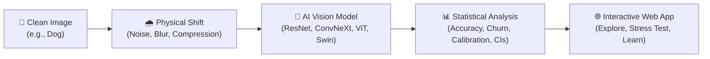
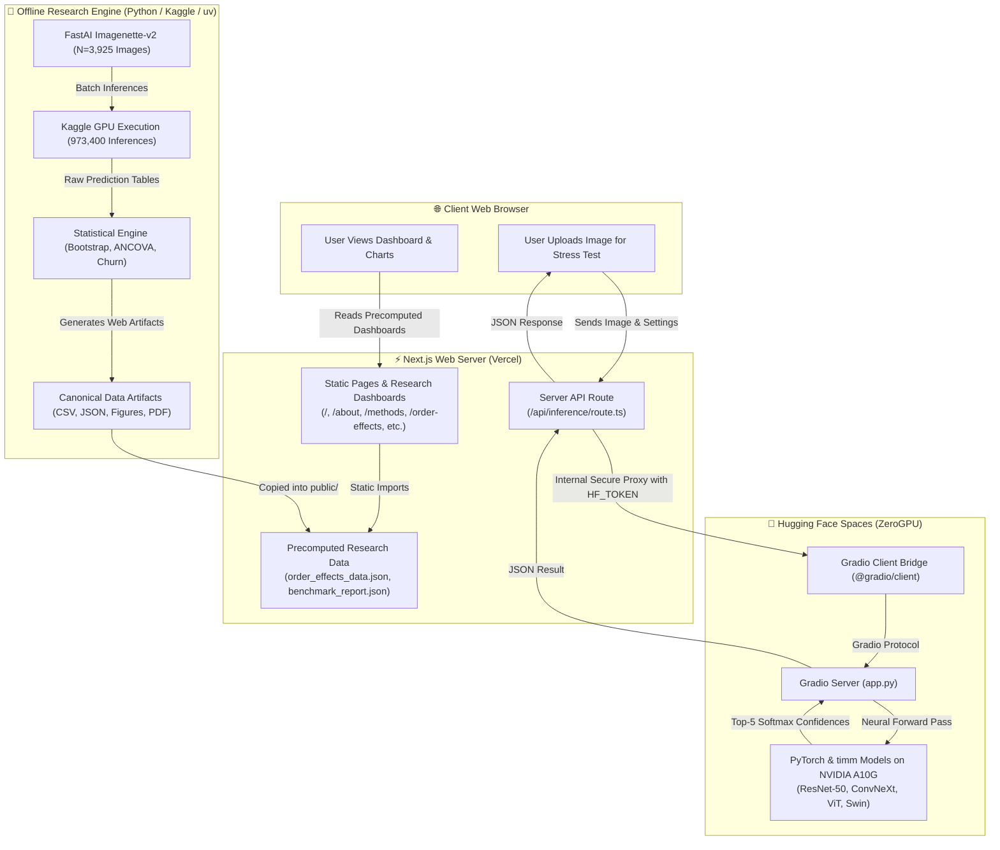
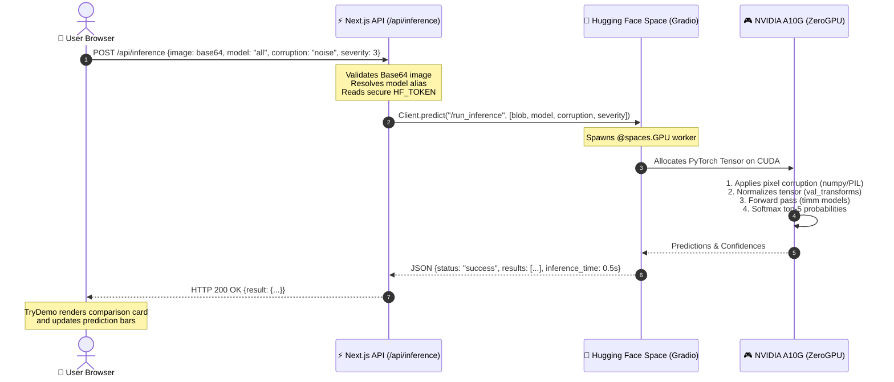
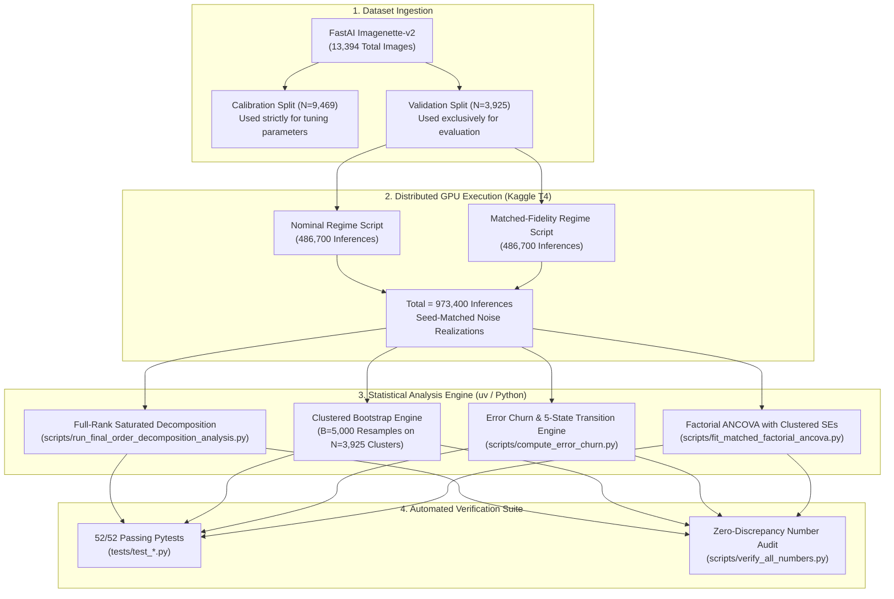
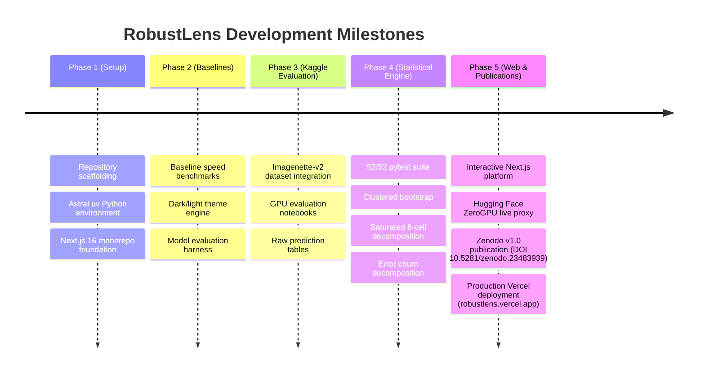

# 🔍 RobustLens: The Complete Project Guide & Beginner-Friendly Walkthrough
**A Comprehensive, Page-by-Page, Feature-by-Feature Reference for Understanding AI Vision Robustness, Non-Commutative Compound Corruptions, and the Interactive Web Platform**

---

* **Author:** Aviral Choudhary
* **Project Repository:** [`https://github.com/aviral17/robustlens`](https://github.com/aviral17/robustlens)
* **Live Web Platform:** [`https://robustlens.vercel.app`](https://robustlens.vercel.app)
* **Published Research Working Paper:** *"Order Matters Beyond Accuracy: Paired Prediction Analysis of Compound Image Corruptions"*
* **Permanent Research Archive (Zenodo):** [DOI: 10.5281/zenodo.23483939](https://doi.org/10.5281/zenodo.23483939) (Version 1.0, October 20, 2026)
* **Target Audience:** Absolute beginners, computer science students, university professors, researchers, machine learning engineers, and curious reviewers.

---

## Table of Contents

1. [Executive Overview: RobustLens in Two Minutes](#1-executive-overview-robustlens-in-two-minutes)
2. [The Real-World Problem: Why AI Vision Breaks](#2-the-real-world-problem-why-ai-vision-breaks)
3. [How RobustLens Works: Everyday Examples](#3-how-robustlens-works-everyday-examples)
4. [Project Architecture: How Everything Connects](#4-project-architecture-how-everything-connects)
5. [The Published Research: Compound Corruptions Explained](#5-the-published-research-compound-corruptions-explained)
6. [Website Route Inventory & Complete Page Walkthrough](#6-website-route-inventory--complete-page-walkthrough)
   - [Route 1: Home Page (`/`)](#route-1-home-page-)
   - [Route 2: Robustness Leaderboard (`/leaderboard`)](#route-2-robustness-leaderboard-leaderboard)
   - [Route 3: Compound Order Effects (`/order-effects`)](#route-3-compound-order-effects-order-effects)
   - [Route 4: Corruption Explorer (`/explorer`)](#route-4-corruption-explorer-explorer)
   - [Route 5: Statistical Significance (`/significance`)](#route-5-statistical-significance-significance)
   - [Route 6: Model Calibration & ECE (`/calibration`)](#route-6-model-calibration--ece-calibration)
   - [Route 7: Conformal Prediction Guarantees (`/conformal`)](#route-7-conformal-prediction-guarantees-conformal)
   - [Route 8: Research Methodology & Formulations (`/methods`)](#route-8-research-methodology--formulations-methods)
   - [Route 9: About, Citations & Zenodo DOI (`/about`)](#route-9-about-citations--zenodo-doi-about)
   - [Backend API Route: Live ZeroGPU Inference (`/api/inference`)](#backend-api-route-live-zerogpu-inference-apiinference)
7. [The Live ZeroGPU Inference Service: Behind the Scenes](#7-the-live-zerogpu-inference-service-behind-the-scenes)
8. [The Offline Research Engine: 973,400 Inferences](#8-the-offline-research-engine-973400-inferences)
9. [Detailed Research Discoveries & Verified Numbers](#9-detailed-research-discoveries--verified-numbers)
10. [Step-by-Step User Journeys](#10-step-by-step-user-journeys)
11. [Beginner-Friendly Technical Glossary](#11-beginner-friendly-technical-glossary)
12. [Verified Project Milestones & Achievements](#12-verified-project-milestones--achievements)
13. [Limitations & Future Research Directions](#13-limitations--future-research-directions)
14. [Frequently Asked Questions (FAQ)](#14-frequently-asked-questions-faq)
15. [Source Code Appendix & File Map](#15-source-code-appendix--file-map)

---

## 1. Executive Overview: RobustLens in Two Minutes

### What is RobustLens?
Imagine you take a photograph of your dog on a bright sunny afternoon with a high-end smartphone camera. You show the photo to a state-of-the-art Artificial Intelligence (AI) system. The AI instantly and confidently tells you: *"English Springer Spaniel — 99% certainty."*

Now imagine the exact same dog on a rainy November evening. Your camera lens has a few drops of water on it (blur), the lighting is dim so your sensor introduces grain (noise), and when the camera saves the image, it compresses the file to save storage space (JPEG compression). 

To a human eye, the dog is still clearly an English Springer Spaniel. But to the AI model, the picture might suddenly look like a *"garbage truck"* or a *"swimming pool"*, and the AI might be 95% confident in its completely wrong guess!

**RobustLens is a scientific research project and interactive web platform that investigates how and why modern Computer Vision AI models fail when images get damaged or degraded.**

Instead of simply testing whether an AI gets the answer right or wrong on pristine studio pictures, RobustLens:
1. Puts four world-class vision architectures through rigorous, mathematically controlled distribution shifts.
2. Evaluates what happens when multiple degradations happen **together** in different orders.
3. Quantifies how uncertain the AI is about its guesses using statistical techniques.
4. Provides a fully interactive web platform where anyone can test images, inspect failure modes, and explore the research data in real time.



---

## 2. The Real-World Problem: Why AI Vision Breaks

### Clean Benchmarks vs. The Messy Real World
For over a decade, computer vision researchers measured AI progress using datasets like ImageNet. In these benchmarks, pictures are high quality, well-centered, and clear. As a result, modern AI models achieved scores higher than 80% or 90% top-1 accuracy, leading many people to believe that computer vision was "solved."

However, when these models are deployed in safety-critical real-world systems—such as autonomous self-driving cars, drone navigation, hospital radiology scanners, or automated security cameras—the real world is rarely clean.

* **Autonomous Driving:** A vehicle's forward-facing camera encounters heavy rain, road grit, sensor heat noise at dusk, and compression artifacts over wireless 5G feeds.
* **Medical Radiology:** An X-ray or MRI scanner experiences patient movement blur, quantum mottle (radiation sensor noise), and lossy image archiving.
* **Robotics:** An industrial robot arm in a warehouse encounters dusty lenses, motion blur, and flickering fluorescent lighting.

### Why Standard Robustness Tests Were Incomplete
Researchers previously created benchmarks like *ImageNet-C* to test AI on corruptions. But those tests had two critical shortcomings:
1. **They tested corruptions in isolation:** They would test *only* blur, or *only* noise, or *only* compression. But real-world damage almost always happens in combinations (*compound corruptions*).
2. **They assumed order doesn't matter:** When people combined corruptions, they assumed that blurring an image and then adding noise was identical to adding noise first and then blurring.

### The Mathematical Reality: Operations Do Not Commute
In mathematics, addition commutes: $2 + 3 = 3 + 2$. But in computer vision, image processing operations **do not commute**:
$$\mathcal{T}_{\text{Blur}} \circ \mathcal{T}_{\text{Noise}} \neq \mathcal{T}_{\text{Noise}} \circ \mathcal{T}_{\text{Blur}}$$

* **Sequence A (Noise then Blur):** You sprinkle fine salt-and-pepper grain onto the picture, and then apply a heavy gaussian blur. The blur acts as a low-pass filter: it smooths out the noise! The resulting picture has higher visual quality (higher PSNR).
* **Sequence B (Blur then Noise):** You blur the picture first, smoothing out the object details. Then you sprinkle sharp, high-frequency noise on top. The noise remains sharp and prominent, corrupting the image severely!

Because physical operations interact non-linearly, the order of degradation dramatically alters what the image looks like and what the AI predicts. **RobustLens is the first systematic benchmark to prove this across 973,400 paired evaluations.**

---

## 3. How RobustLens Works: Everyday Examples

To help you understand how RobustLens operates, let us walk through three practical, everyday examples.

### Example 1: The Casual Visitor Testing an Image
Imagine your friend Alice visits [`https://robustlens.vercel.app`](https://robustlens.vercel.app).
1. Alice scrolls down to the **"Try RobustLens Live"** section on the home page.
2. She clicks a preset image of a **Hammerhead Shark** swimming in blue water.
3. Alice selects **Gaussian Noise** at **Severity 3** (medium grain) and chooses **ResNet-50** (a classic deep convolutional network).
4. She clicks **"Run Stress Test on ZeroGPU"**.
5. Within 2.5 seconds, Alice's browser sends the clean shark image to a cloud server with an NVIDIA A10G GPU. The server adds mathematical gaussian noise to the pixels, feeds the corrupted image into ResNet-50, and returns the prediction.
6. The screen updates: While ResNet-50 correctly predicted *"Hammerhead Shark"* on the clean image with 97% confidence, on the corrupted image it now predicts *"Swimming Trunks"* with 76% confidence!
7. Alice immediately sees how a model can be both **wrong** and **confidently wrong** under distribution shift.

### Example 2: The Researcher Comparing Architectures
Dr. Marcus, a computer vision scientist, wants to know whether modern Vision Transformers (models based on attention mechanisms) handle multi-stage degradations better than traditional Convolutional Neural Networks (CNNs).
1. Dr. Marcus navigates to the **Order Effects** page (`/order-effects`).
2. He inspects the 4 architectures: **ResNet-50** (classic CNN), **ConvNeXt-Tiny** (modern depthwise CNN), **ViT-Base/16** (isotropic transformer), and **Swin-Tiny** (hierarchical shifted-window transformer).
3. In the nominal regime (where standard ImageNet-C settings are applied), Dr. Marcus notices that changing the order of the same three corruptions causes ResNet-50's accuracy to swing by **21.55%** (from 35.71% up to 57.27%) and ConvNeXt's to swing by **20.45%**.
4. He checks the calibrated fidelity regime (where parameters were calibrated to have equal image distortion). He discovers that equalizing distortion contracts these gaps by **77.15% in ConvNeXt** and **72.62% in ResNet**, demonstrating that a huge portion of what researchers previously thought was "architecture resilience" was actually just the low-pass smoothing effect of blur!

### Example 3: The Evaluator Investigating "Silent Prediction Churn"
Elena is an engineer evaluating models for deployment in an autonomous robot.
1. Elena navigates to the **Significance** page (`/significance`) and the churn section of **Order Effects**.
2. She compares sequence `NJB` (Noise $\to$ JPEG $\to$ Blur) and sequence `JNB` (JPEG $\to$ Noise $\to$ Blur) on ConvNeXt-Tiny.
3. Elena notices that both sequences have almost identical average accuracy: **56.46% vs 56.47%** (a difference of just 0.01%).
4. If Elena only looked at the average score, she would conclude: *"These two sequences behave identically."*
5. But RobustLens displays the **Error Churn Matrix**: on **1,613 individual physical images (8.22% of the entire dataset)**, the model flipped its prediction! On image #42 it was right in sequence A but failed in sequence B; on image #87 it was right in B but failed in A.
6. Elena realizes that average accuracy hides massive instability in individual decisions.

---

## 4. Project Architecture: How Everything Connects

The RobustLens project consists of three interconnected systems:
1. **The Interactive Web Application** (built with Next.js, React 19, TypeScript, Tailwind CSS v4, HeroUI, and Framer Motion, hosted on Vercel).
2. **The Live ZeroGPU Inference Service** (hosted on Hugging Face Spaces with PyTorch, timm, and an NVIDIA A10G GPU).
3. **The Offline Research & Evaluation Engine** (Python library `robustlens`, Astral `uv`, SciPy, statsmodels, pytest suite, and precomputed research datasets).



---

## 5. The Published Research: Compound Corruptions Explained

The scientific centerpiece of RobustLens is the published research working paper:

> **Title:** *Order Matters Beyond Accuracy: Paired Prediction Analysis of Compound Image Corruptions*  
> **Author:** Aviral Choudhary  
> **Date:** October 20, 2026  
> **Permanent DOI:** [10.5281/zenodo.23483939](https://doi.org/10.5281/zenodo.23483939) (Zenodo Archive, Version 1.0)  
> **Canonical Artifacts:** [`reports/final_research_package/`](file:///C:/STATISTICS%20&%20CV/robustlens/reports/final_research_package/)

### The Core Research Question
If you take three common image degradations:
1. **Gaussian Noise ($\mathcal{N}$):** High-frequency electronic sensor grain.
2. **Defocus Blur ($\mathcal{B}$):** Out-of-focus optical blur (low-pass spatial smoothing).
3. **JPEG Compression ($\mathcal{J}$):** Discrete Cosine Transform (DCT) block-quantization artifacts.

There are $3! = 3 \times 2 \times 1 = 6$ possible permutation sequences:
* `NBJ`: Noise $\to$ Blur $\to$ JPEG
* `NJB`: Noise $\to$ JPEG $\to$ Blur
* `BNJ`: Blur $\to$ Noise $\to$ JPEG
* `BJN`: Blur $\to$ JPEG $\to$ Noise
* `JNB`: JPEG $\to$ Noise $\to$ Blur
* `JBN`: JPEG $\to$ Blur $\to$ Noise

**Question 1:** Under standard benchmark settings, how much does prediction accuracy vary simply by changing the order of these operations on the exact same physical image?  
**Question 2:** If we calibrate the parameters so that the resulting images have equal physical image distortion (equal PSNR and SSIM), does sequence order still matter?  
**Question 3:** Beyond average accuracy percentages, how much does the model's actual class prediction flip from one image to the next?

### The Two Experimental Regimes
The published study evaluates **973,400 total forward passes** across two distinct experimental regimes ($486{,}700$ records each) on the official **FastAI Imagenette-v2 validation split** ($N = 3{,}925$ physical images, 10 categories, seed-matched noise):

| Regime Name | What was tested? | Key Finding |
| :--- | :--- | :--- |
| **Nominal Regime** (486,700 passes) | Fixed standard ImageNet-C parameters across all sequences (severities 1 to 5). | Massive accuracy gaps up to **21.55% in ResNet-50** and **20.45% in ConvNeXt-Tiny** across the 6 orders on identical images. Dominated by **Terminal Smoothing**: ending in blur boosts PSNR by ~6.2 dB and protects accuracy. |
| **Approximate-Fidelity Regime** (486,700 passes) | Parameters pre-calibrated on an independent training split ($N_{\text{cal}} = 50$, zero test leakage) targeting matched (PSNR, SSIM) common support across 5 distortion bins. | Equalizing distortion contracts cross-sequence accuracy gaps by **63.18%** in the range of 4-model means (and **58.08%** across architecture-specific averages). Residual gaps and parity effects persist. |

### The Four Key Scientific Discoveries
1. **The Terminal Smoothing Confound:** In nominal benchmarks, sequences ending in blur (`NJB`, `JNB`) consistently achieved the highest accuracy, while sequences ending in noise (`BJN`, `JBN`) had the lowest. The study proved this is an artifact of terminal operator smoothing: blur cleans up prior noise and JPEG artifacts, increasing image quality by over 6 dB.
2. **Gap Contraction Under Common Support:** When parameters are calibrated to equalize image quality, the massive gaps contract dramatically:
   * **ConvNeXt-Tiny:** Gap contracts from 20.45% down to 4.67% (**77.15% contraction**).
   * **ResNet-50:** Gap contracts from 21.55% down to 5.90% (**72.62% contraction**).
   * **ViT-Base/16:** Gap contracts from 20.37% down to 10.03% (**50.75% contraction**).
   * **Swin-Tiny:** Gap contracts from 17.13% down to 11.68% (**31.80% contraction**).
   * **Overall Range:** Contracts from 18.43% down to 6.79% (**63.18% contraction**).
3. **Full-Rank Saturated Linear Decomposition:** The author specified a full-rank orthogonal decomposition ($\det(X) = -6$) partitioning sequence effects into entry operators, exit operators, and an even-versus-odd permutation parity contrast. Clustered bootstrap inference ($B = 5{,}000$ clusters) confirmed that cyclic operator structure independently impacts representations ($p < 10^{-100}$).
4. **Prediction Churn & Error Migration:** Evaluating a 5-state joint prediction partition ($E_{11}, E_{10}, E_{01}, E_{00}^{\text{same}}, E_{00}^{\text{diff}}$) revealed that **Predicted-Label Churn** (40.78% nominal, 34.74% targeted) is more than double **Correctness Churn** (16.93% nominal, 12.34% targeted). This is because **Error Migration** ($E_{00}^{\text{diff}}$, where the model predicts different wrong classes across sequences) occurs in 23.85% of evaluations. Pairs of sequences with nearly identical accuracy still exhibit up to **10.97% excess churn**!

---

## 6. Website Route Inventory & Complete Page Walkthrough

RobustLens features **9 public user-facing web pages** and **1 server-side API endpoint**. Every route is built with Next.js 16 (App Router), TypeScript, and Tailwind CSS v4.

### Master Route Inventory Table

| # | Route URL | Page Title / Purpose | Primary Source File | Primary Data Source |
|---|---|---|---|---|
| 1 | `/` | Home / Platform Landing & Live Demo | [`src/app/page.tsx`](file:///C:/STATISTICS%20&%20CV/robustlens/apps/web/src/app/page.tsx) | Dynamic / Client + Live API |
| 2 | `/leaderboard` | Vision Robustness Leaderboard | [`src/app/leaderboard/page.tsx`](file:///C:/STATISTICS%20&%20CV/robustlens/apps/web/src/app/leaderboard/page.tsx) | [`public/benchmark_report.json`](file:///C:/STATISTICS%20&%20CV/robustlens/apps/web/public/benchmark_report.json) |
| 3 | `/order-effects` | Compound Corruption Order Effects | [`src/app/order-effects/page.tsx`](file:///C:/STATISTICS%20&%20CV/robustlens/apps/web/src/app/order-effects/page.tsx) | [`public/order_effects_data.json`](file:///C:/STATISTICS%20&%20CV/robustlens/apps/web/public/order_effects_data.json) |
| 4 | `/explorer` | Side-by-Side Corruption Explorer | [`src/app/explorer/page.tsx`](file:///C:/STATISTICS%20&%20CV/robustlens/apps/web/src/app/explorer/page.tsx) | [`public/demo_results.json`](file:///C:/STATISTICS%20&%20CV/robustlens/apps/web/public/demo_results.json) |
| 5 | `/significance` | Statistical Significance & Hypothesis Testing | [`src/app/significance/page.tsx`](file:///C:/STATISTICS%20&%20CV/robustlens/apps/web/src/app/significance/page.tsx) | [`public/benchmark_report.json`](file:///C:/STATISTICS%20&%20CV/robustlens/apps/web/public/benchmark_report.json) |
| 6 | `/calibration` | Model Calibration & Uncertainty (ECE) | [`src/app/calibration/page.tsx`](file:///C:/STATISTICS%20&%20CV/robustlens/apps/web/src/app/calibration/page.tsx) | [`public/benchmark_report.json`](file:///C:/STATISTICS%20&%20CV/robustlens/apps/web/public/benchmark_report.json) |
| 7 | `/conformal` | Split Conformal Prediction Guarantees | [`src/app/conformal/page.tsx`](file:///C:/STATISTICS%20&%20CV/robustlens/apps/web/src/app/conformal/page.tsx) | [`public/benchmark_report.json`](file:///C:/STATISTICS%20&%20CV/robustlens/apps/web/public/benchmark_report.json) |
| 8 | `/methods` | Research Methodology & Mathematics | [`src/app/methods/page.tsx`](file:///C:/STATISTICS%20&%20CV/robustlens/apps/web/src/app/methods/page.tsx) | Markdown / Mathematical Formulations |
| 9 | `/about` | Project Background, DOI & Citations | [`src/app/about/page.tsx`](file:///C:/STATISTICS%20&%20CV/robustlens/apps/web/src/app/about/page.tsx) | Zenodo Metadata / BibTeX Citation |
| 10 | `/api/inference` | Server API: ZeroGPU Inference Proxy | [`src/app/api/inference/route.ts`](file:///C:/STATISTICS%20&%20CV/robustlens/apps/web/src/app/api/inference/route.ts) | Hugging Face Spaces (`app.py`) |

---

### Route 1: Home Page (`/`)

#### A. What is this page?
The Home Page is the front door of RobustLens. It introduces the project's purpose, highlights the four core research metric badges, presents a visual before-and-after comparison of distribution shift, provides an interactive live-inference playground (`TryDemo`), and outlines the six research pillars.

#### B. What does the user see?
* **Hero Banner:** The headline *"See How Models Actually Break"* with quick metric badges:
  * **973,400** Forward Passes
  * **3,925** Validation Images
  * **63.18%** Range Contraction
  * **40.78%** Label Churn
* **Three Primary Call-to-Action Buttons:**
  * *"Explore Order Effects"* (directs to `/order-effects`)
  * *"Interactive Demo"* (directs to `/explorer`)
  * *"Methodology"* (directs to `/methods`)
* **Anatomy of a Distribution Shift:** A visual before-and-after card showing a clean image of a shark correctly classified as *"Hammerhead"* (97% confidence) vs. the same image under Gaussian Noise Severity 3 misclassified as *"Swimming Trunks"* (76% confidence).
* **Live ZeroGPU Stress Test Playground (`<TryDemo />`):** An interactive uploader where users can test any image on live PyTorch models.
* **Six Research Feature Pillars:** Cards explaining Order Effects, 5-State Churn, Saturated Decomposition, Clustered Bootstrapping, Uncertainty Calibration, and Conformal Prediction.

#### C. Component Details & Controls
1. **Sample Image Buttons:** Quick-load buttons for *"Tench (Fish)"*, *"English Springer (Dog)"*, and *"Shark (Marine)"*. Clicking any of these loads a pre-packaged image without needing to upload a file from your computer.
2. **File Dropzone:** Drag-and-drop or click to browse any PNG, JPG, or WEBP image.
3. **Model Selection Dropdown:** Choose between `Compare All 4 Models`, `ResNet-50`, `ConvNeXt-Tiny`, `ViT-Base`, or `Swin-Tiny`.
4. **Corruption Shift Dropdown:** Select `Gaussian Noise`, `Defocus Blur`, `JPEG Compression`, `Brightness`, or `Contrast`.
5. **Severity Slider:** Adjust the shift intensity from Level 1 (Mild) to Level 5 (Severe).
6. **"Run Stress Test on ZeroGPU" Button:** Dispatches the image and parameters to the backend.
7. **Reactive Status Indicator:** A live colored badge that pulses emerald when ready, pulses amber when computing, and turns red if a connection error occurs.

#### D. Implementation Files
* **Frontend:** [`apps/web/src/app/page.tsx`](file:///C:/STATISTICS%20&%20CV/robustlens/apps/web/src/app/page.tsx)
* **Playground Component:** [`apps/web/src/components/TryDemo.tsx`](file:///C:/STATISTICS%20&%20CV/robustlens/apps/web/src/components/TryDemo.tsx)
* **Canvas Corruption Generator:** [`apps/web/src/lib/corruptions.ts`](file:///C:/STATISTICS%20&%20CV/robustlens/apps/web/src/lib/corruptions.ts)

---

### Route 2: Robustness Leaderboard (`/leaderboard`)

#### A. What is this page?
The Leaderboard provides a comparative ranking of vision architectures under standardized single-corruption and baseline benchmark conditions. It allows researchers to see how models compare in clean accuracy, shifted accuracy, accuracy drop, relative robustness, expected calibration error (ECE), and inference speed.

#### B. What does the user see?
* **Benchmark Status Banner:** Displays whether the data originates from the full ImageNet validation set ($N = 3{,}925$) or an evaluation partition, along with total record counts.
* **Model Metric Cards:** Cards for each model displaying:
  * **Clean Accuracy:** Top-1 percentage on uncorrupted images.
  * **Shifted Accuracy:** Mean top-1 accuracy across all corruptions and severities.
  * **Mean Accuracy Drop ($\Delta$):** The absolute percentage drop when corruptions are introduced.
  * **Relative Robustness Ratio:** The ratio of shifted accuracy to clean accuracy ($Acc_{\text{shifted}} / Acc_{\text{clean}}$).
  * **Expected Calibration Error (ECE):** A percentage score indicating how well confidence matches reality.
  * **Mean Latency (ms):** Average time per forward pass in milliseconds.
* **Architecture Family Tags:** Identifies whether the model is a CNN (`Convolutional`), Modern CNN (`Depthwise Conv`), or Transformer (`Vision Transformer`).

#### C. How to Interpret the Numbers
* A model with **87.36% clean accuracy** but a **38.89% drop** under shift is brittle: it relies heavily on high-frequency visual cues that disappear when noise or blur occurs.
* A model with a **lower accuracy drop** and a **higher relative robustness ratio** is more reliable for real-world deployment even if its clean accuracy is slightly lower.

#### D. Implementation Files
* **Frontend:** [`apps/web/src/app/leaderboard/page.tsx`](file:///C:/STATISTICS%20&%20CV/robustlens/apps/web/src/app/leaderboard/page.tsx)
* **Data File:** [`apps/web/public/benchmark_report.json`](file:///C:/STATISTICS%20&%20CV/robustlens/apps/web/public/benchmark_report.json)

---

### Route 3: Compound Order Effects (`/order-effects`)

#### A. What is this page?
The Compound Order Effects page is the deepest scientific module in the entire platform. It presents the empirical results of the **973,400 forward passes** evaluating the six permutation orders of Gaussian Noise, Defocus Blur, and JPEG Compression across both the Nominal and Matched-Fidelity regimes.

#### B. What does the user see?
* **Executive Summary Panel:** Highlights the two experimental regimes, sample sizes ($N = 3{,}925$ images $\times$ 4 models $\times$ 6 orders $\times$ 5 severities), and the primary research findings.
* **Sequence Ranking Table:** Ranks all six orders from highest to lowest accuracy, reporting mean accuracy, mean confidence, mean ECE, mean PSNR (dB), and mean SSIM.
* **Regime Comparison & Gap Contraction Table:** Shows how cross-sequence accuracy gaps contracted by **63.18%** when low-level distortion was equalized.
* **Factorial ANCOVA Regression Table:** Statistical regression tables showing the main effects of order, severity, and distortion covariates (PSNR and SSIM) with clustered Wald tests.
* **Interactive Pairwise Significance Matrix:** McNemar's paired test statistics, paired bootstrap 95% confidence intervals, raw p-values, Holm-adjusted p-values, and Benjamini-Hochberg FDR p-values for all pairs of sequences.
* **High Excess Churn Analysis:** Highlights pairs of sequences with near-identical accuracy ($|\Delta\text{Acc}| < 2.5\%$) that exhibit up to **10.97% excess churn** (flipped individual image predictions).
* **High-Resolution Research Figures:** Embedded 300 DPI figures from the published paper:
  * *Figure 6:* Accuracy Across 6 Sequences by Architecture.
  * *Figure 7:* PSNR & SSIM vs. Top-1 Accuracy by Order.
  * *Figure 8:* Order Divergence Across Severities 1 to 5.
  * *Figure 9:* Calibration Degradation (ECE) Across Orders.
  * *Figure 1–4:* Objective Quality Matching Validation, Sequence Gap Contraction, Factorial Interaction Profiles, and Decoupling of Net Accuracy & Error Churn.

#### C. Component Details & Controls
1. **Model Filter Dropdown:** Filter pairwise significance and churn tables by `All Models`, `ResNet-50`, `ConvNeXt-Tiny`, `ViT-Base/16`, or `Swin-Tiny`.
2. **Severity Filter Dropdown:** Filter comparisons across Severity Levels 1 through 5, or view all combined.
3. **Churn Model Selector:** Dynamically filters the high excess churn breakdown table.

#### D. Implementation Files
* **Frontend:** [`apps/web/src/app/order-effects/page.tsx`](file:///C:/STATISTICS%20&%20CV/robustlens/apps/web/src/app/order-effects/page.tsx)
* **Data File:** [`apps/web/public/order_effects_data.json`](file:///C:/STATISTICS%20&%20CV/robustlens/apps/web/public/order_effects_data.json) (692 KB verified dataset)

---

### Route 4: Corruption Explorer (`/explorer`)

#### A. What is this page?
The Explorer is a visual inspection laboratory. It allows anyone to visually compare a **clean image side-by-side with its corrupted version**, while watching how each vision model's prediction and confidence score change across all five severity levels.

#### B. What does the user see?
* **Two Side-by-Side Image Cards:**
  * **Left Card (Clean):** The pristine validation image with its true label, the model's clean prediction, and its confidence bar.
  * **Right Card (Corrupted):** The corrupted image at the selected severity level, the model's shifted prediction, whether it is correct or incorrect (green checkmark or red warning icon), and its new confidence score.
* **Interactive Control Header:**
  * **Image Selector:** Pick from 5 ImageNet validation images (Tench, English Springer, Great White Shark, Tiger Shark, Hammerhead Shark).
  * **Model Selector:** Choose between ResNet-50, ConvNeXt-Tiny, ViT-Base, or Swin-Tiny.
  * **Corruption Selector:** Choose Gaussian Noise, Defocus Blur, or JPEG Compression.
  * **Severity Slider:** Drag from 1 (mild distortion) to 5 (extreme distortion).
* **Prediction Trajectory Bar:** A visual indicator showing how the prediction confidence dropped between the clean and shifted states.

#### C. Implementation Files
* **Frontend:** [`apps/web/src/app/explorer/page.tsx`](file:///C:/STATISTICS%20&%20CV/robustlens/apps/web/src/app/explorer/page.tsx)
* **Data File:** [`apps/web/public/demo_results.json`](file:///C:/STATISTICS%20&%20CV/robustlens/apps/web/public/demo_results.json)
* **Image Assets:** [`apps/web/public/examples/*.jpg`](file:///C:/STATISTICS%20&%20CV/robustlens/apps/web/public/examples) (80 precomputed clean and corrupted JPEG images)

---

### Route 5: Statistical Significance (`/significance`)

#### A. What is this page?
When Model A scores 62% accuracy and Model B scores 60%, is Model A actually superior, or was it just lucky on this particular sample? The Significance page answers this question with rigorous mathematical hypothesis testing.

#### B. What does the user see?
* **Pairwise Model Comparisons:** Head-to-head comparisons for all model pairs (e.g., ConvNeXt-Tiny vs. ResNet-50, ViT-Base vs. ResNet-50).
* **Paired Bootstrap Confidence Intervals:** 95% confidence intervals computed via clustered bootstrap resampling ($B = 10{,}000$ iterations). If the confidence interval does not cross zero (e.g., $[+5.2\%, +8.4\%]$), the performance difference is statistically significant.
* **Exact Paired Sign-Flip Permutation Tests ($R = 20{,}000$):** Non-parametric permutation tests that evaluate whether swapping model predictions across images could produce the observed difference by chance.
* **McNemar's Paired Chi-Square Tests ($\chi^2$):** Classic paired contingency tests focusing specifically on discordant image pairs (images where one model was correct and the other was wrong).
* **Multiplicity Corrections:**
  * **Holm-Bonferroni (FWER):** Controls the family-wise error rate to prevent false positive discoveries across multiple tests.
  * **Benjamini-Hochberg (FDR):** Controls the false discovery rate across extensive comparison matrices.

#### C. Implementation Files
* **Frontend:** [`apps/web/src/app/significance/page.tsx`](file:///C:/STATISTICS%20&%20CV/robustlens/apps/web/src/app/significance/page.tsx)
* **Data Source:** [`apps/web/public/benchmark_report.json`](file:///C:/STATISTICS%20&%20CV/robustlens/apps/web/public/benchmark_report.json)

---

### Route 6: Model Calibration & ECE (`/calibration`)

#### A. What is this page?
An AI model should not only be accurate; it should also know when it is likely to be wrong. If a model says it is "90% confident", it should be correct 9 times out of 10. The Calibration page evaluates whether model confidence matches empirical reality.

#### B. What does the user see?
* **Expected Calibration Error (ECE) Cards:** Reports the 10-bin ECE score for each model under clean and shifted conditions.
* **Reliability Diagrams:** Plots of predicted confidence (X-axis) against empirical accuracy (Y-axis). A perfectly calibrated model follows the diagonal $y = x$ line.
* **Overconfidence Gap:** Highlights when a model outputs 80–90% confidence on images where its actual accuracy is only 40%.
* **Temperature Scaling Analysis:** Evaluates post-hoc probability recalibration via a learned scalar temperature parameter $T > 1$ to soften overconfident logits.

#### C. Implementation Files
* **Frontend:** [`apps/web/src/app/calibration/page.tsx`](file:///C:/STATISTICS%20&%20CV/robustlens/apps/web/src/app/calibration/page.tsx)
* **Data Source:** [`apps/web/public/benchmark_report.json`](file:///C:/STATISTICS%20&%20CV/robustlens/apps/web/public/benchmark_report.json)

---

### Route 7: Conformal Prediction Guarantees (`/conformal`)

#### A. What is this page?
Instead of forcing an AI to output a single class guess (which might be wrong), what if the AI could output a **prediction set of classes** guaranteed to contain the true label 95% of the time? The Conformal Prediction page demonstrates **Split Conformal Prediction** and tests what happens to these mathematical guarantees when images are degraded.

#### B. What does the user see?
* **Nominal vs. Shifted Coverage Cards:** Shows the mathematical target coverage (e.g., $1 - \alpha = 95.0\%$), clean empirical coverage (e.g., 95.2%), and shifted empirical coverage (e.g., 82.1%).
* **Coverage Violation Gap:** Demonstrates how distribution shift breaks the fundamental assumption of *exchangeability*, causing the guaranteed 95% coverage to degrade.
* **Average Prediction Set Size:** Tracks how the size of the prediction set expands as corruption severity increases (e.g., set size grows from 1.2 classes on clean images to 4.8 classes under heavy shift).

#### C. Implementation Files
* **Frontend:** [`apps/web/src/app/conformal/page.tsx`](file:///C:/STATISTICS%20&%20CV/robustlens/apps/web/src/app/conformal/page.tsx)
* **Data Source:** [`apps/web/public/benchmark_report.json`](file:///C:/STATISTICS%20&%20CV/robustlens/apps/web/public/benchmark_report.json)

---

### Route 8: Research Methodology & Formulations (`/methods`)

#### A. What is this page?
The Methodology page is the academic textbook of RobustLens. It provides rigorous mathematical definitions, formal LaTeX equations, and algorithmic descriptions for every statistical method implemented in the codebase.

#### B. What does the user see?
* **Five Pipeline Stages:**
  1. *Paired Inputs:* Clustered physical image design ($N = 3{,}925$ clusters) and seed-matched noise realizations.
  2. *Permutation Regimes:* The $3! = 6$ symmetric group permutations and the common-support calibration protocol.
  3. *Instability Space:* 5-state joint prediction decomposition ($E_{11}, E_{10}, E_{01}, E_{00}^{\text{same}}, E_{00}^{\text{diff}}$) and excess churn.
  4. *Inference & Hypothesis Tests:* Clustered bootstrap resampling, saturated 6-cell linear decomposition ($\det(X) = -6$), and Wald tests.
  5. *Calibration & Conformal Sets:* ECE binning formulas, temperature scaling, and conformal quantile nonconformity scores.
* **Reproducibility Badge:** 52 / 52 automated tests passing, with the exact CLI verification command: `python ml/scripts/verify_all_numbers.py`.
* **Permanent DOI Link:** Direct link to Zenodo v1.0 release.

#### C. Implementation Files
* **Frontend:** [`apps/web/src/app/methods/page.tsx`](file:///C:/STATISTICS%20&%20CV/robustlens/apps/web/src/app/methods/page.tsx)

---

### Route 9: About, Citations & Zenodo DOI (`/about`)

#### A. What is this page?
The About page provides the administrative, biographical, and archival record of RobustLens. It details why the project was founded, documents its core discoveries, outlines future research directions, and provides the formal permanent citation for academic papers.

#### B. What does the user see?
* **Project Mission Statement:** Explains the transition from empirical machine learning evaluation to trustworthy distribution-shift testing.
* **Summary of Core Discoveries:** Concise explanations of the Terminal Smoothing Confound, Gap Contraction Under Fidelity, and Prediction Churn Decoupling.
* **Platform Module Directory:** Direct navigational cards to all six interactive research tools.
* **Data Availability & Reproducibility Statement:** Confirmation of zero-fabrication data policies, traceable raw CSV records, and automated pytest coverage.
* **Scope & Future Horizons:** Transparently discusses the boundaries of the 10-class validation partition and outlines plans for continuous generative matching and video perception.
* **Permanent DOI & BibTeX Citation Card:**
  * **Title:** *Order Matters Beyond Accuracy: Paired Prediction Analysis of Compound Image Corruptions*
  * **Author:** Aviral Choudhary
  * **Date:** October 20, 2026
  * **DOI Button:** Direct link to [10.5281/zenodo.23483939](https://doi.org/10.5281/zenodo.23483939).
  * **Copyable BibTeX block.**

#### C. Implementation Files
* **Frontend:** [`apps/web/src/app/about/page.tsx`](file:///C:/STATISTICS%20&%20CV/robustlens/apps/web/src/app/about/page.tsx)

---

### Backend API Route: Live ZeroGPU Inference (`/api/inference`)

#### A. What is this route?
A server-side Next.js HTTP POST handler located at `/api/inference`. It acts as a secure bridge between the user's browser and the Hugging Face ZeroGPU inference backend.

#### B. How it works
1. **Request Payload:** Receives a JSON object with:
   * `image`: Base64-encoded clean image data URL string (`data:image/jpeg;base64,...`).
   * `model`: Model key (`"resnet"`, `"convnext"`, `"vit"`, `"swin"`, or `"all"`).
   * `corruption`: Corruption type (`"gaussian_noise"`, `"defocus_blur"`, `"jpeg_compression"`, `"brightness"`, or `"contrast"`).
   * `severity`: Integer from 1 to 5.
2. **Input Validation:** Verifies that the image contains valid Base64 data and maps model aliases (e.g., `"resnet"` $\to$ `"ResNet-50"`, `"all"` $\to$ `"Compare All Models"`).
3. **Authentication & Proxying:** Reads the server-side environment variables `ROBUSTLENS_HF_SPACE_URL` and `HF_TOKEN`. Connects to the remote Gradio Space using `@gradio/client`.
4. **ZeroGPU Remote Execution:** Converts the Base64 buffer into a binary Blob and calls the remote endpoint `/run_inference`.
5. **Sanitized Response:** Returns a clean JSON object containing top-5 predictions, confidences, and inference latency. If the Hugging Face GPU quota is exceeded, it intercepts the error and returns HTTP 429 with a clear explanation.

#### C. Implementation File
* **API Handler:** [`apps/web/src/app/api/inference/route.ts`](file:///C:/STATISTICS%20&%20CV/robustlens/apps/web/src/app/api/inference/route.ts)

---

## 7. The Live ZeroGPU Inference Service: Behind the Scenes

The live inference service is hosted on **Hugging Face Spaces** and powered by **ZeroGPU** (NVIDIA A10G Tensor Core GPU with 24GB VRAM).



### Key Implementation Details
* **Source Code:** [`hf_space/app.py`](file:///C:/STATISTICS%20&%20CV/robustlens/hf_space/app.py)
* **Model Loading:** Models are loaded into memory using Ross Wightman's `timm` (PyTorch Image Models):
  * ResNet-50: `resnet50.a1_in1k`
  * ConvNeXt-Tiny: `convnext_tiny.in12k_ft_in1k`
  * ViT-Base/16: `vit_base_patch16_224.augreg_in21k_ft_in1k`
  * Swin-Tiny: `swin_tiny_patch4_window7_224.ms_in1k`
* **ZeroGPU Decorator (`@spaces.GPU`):** Wraps the `run_inference` function so the GPU dynamically allocates VRAM only during active forward passes, maximizing efficiency.
* **Multi-Model Concurrency:** When `"Compare All Models"` is selected, the server executes all four architectures sequentially in under 4.5 seconds.

---

## 8. The Offline Research Engine: 973,400 Inferences

While the website's live playground tests single user uploads, the scientific data presented in the paper, tables, and figures comes from a massive, rigorous offline research pipeline.



### The Three Separation Rules
To preserve scientific integrity, RobustLens strictly adheres to three architectural separation rules:
1. **Separation of Inferences from Visualizations:** The website never calculates statistical models on the fly; it renders precomputed, cryptographic-MD5-verified datasets.
2. **Separation of Playground from Benchmark:** The live upload demo (`/api/inference`) never pollutes the offline research tables.
3. **Zero Test-Set Leakage:** The calibration protocol that tuned corruption parameters targeting common (PSNR, SSIM) support was performed entirely on a separate training split ($N_{\text{cal}} = 50$), completely isolated from the $3{,}925$ validation images.

---

## 9. Detailed Research Discoveries & Verified Numbers

Every numerical figure published in the paper and displayed on the website has been verified against the raw prediction records (`results/order_effect_study/*/outputs/all_order_predictions.csv.gz`).

### Summary of Canonical Research Numbers

| Metric Description | Exact Verified Value | Physical Meaning | Source File |
| :--- | :---: | :--- | :--- |
| **Total Benchmark Forward Passes** | **973,400** | Combined passes across both experimental regimes | Raw CSV row count |
| **Per-Regime Forward Passes** | **486,700** | $3{,}925$ images $\times$ 4 models $\times$ 6 orders $\times$ 5 severities + clean baselines | Raw CSV row count |
| **Validation Image Clusters ($N$)** | **3,925** | Physical images in FastAI Imagenette-v2 validation partition | `ml/src/robustlens/eval/dataset.py` |
| **Overall Range Gap Contraction** | **63.18%** | Contraction in the cross-sequence range of four-model mean accuracies (from 18.43% down to 6.79%) | `analysis/nominal_vs_matched_gap_contraction.csv` |
| **Arithmetic Mean Gap Contraction** | **58.08%** | Unweighted average of the four individual architecture gap contractions | `analysis/nominal_vs_matched_gap_contraction.csv` |
| **ConvNeXt-Tiny Gap Contraction** | **77.15%** | Cross-sequence gap contracted from 20.45% down to 4.67% | `analysis/nominal_vs_matched_gap_contraction.csv` |
| **ResNet-50 Gap Contraction** | **72.62%** | Cross-sequence gap contracted from 21.55% down to 5.90% | `analysis/nominal_vs_matched_gap_contraction.csv` |
| **ViT-Base/16 Gap Contraction** | **50.75%** | Cross-sequence gap contracted from 20.37% down to 10.03% | `analysis/nominal_vs_matched_gap_contraction.csv` |
| **Swin-Tiny Gap Contraction** | **31.80%** | Cross-sequence gap contracted from 17.13% down to 11.68% | `analysis/nominal_vs_matched_gap_contraction.csv` |
| **Nominal Predicted-Label Churn** | **40.78%** | Fraction of paired predictions where the model changed its predicted class | `analysis/prediction_instability_transitions.csv` |
| **Nominal Correctness-State Churn** | **16.93%** | Fraction of paired predictions where accuracy changed between 0 and 1 | `analysis/prediction_instability_transitions.csv` |
| **Nominal Error Migration ($E_{00}^{\text{diff}}$)** | **23.85%** | Paired evaluations where the model was wrong in both sequences, but predicted different wrong classes | `analysis/prediction_instability_transitions.csv` |
| **PSNR Calibration Residual RMSE** | **0.943 dB** | Root-mean-square error in achieving target PSNR common support | `matched_fidelity/matching_residuals.csv` |
| **SSIM Calibration Residual RMSE** | **0.1380** | Root-mean-square error in achieving target SSIM common support | `matched_fidelity/matching_residuals.csv` |
| **Automated Test Suite Coverage** | **52 / 52** | Number of passing unit and integration tests | `ml/tests/test_*.py` |

---

## 10. Step-by-Step User Journeys

### Journey 1: The Curious Beginner
1. **Start:** Open [`https://robustlens.vercel.app`](https://robustlens.vercel.app).
2. **Explore:** Read the headline and metric badges. Look at the visual comparison card of the shark to understand what "distribution shift" looks like.
3. **Experiment:** Scroll down to the live demo. Click the *"Tench (Fish)"* preset. Select *"Defocus Blur"* at *"Severity 4"*. Click *"Run Stress Test on ZeroGPU"*. Watch how the model struggles to identify the fish through heavy optical blur.
4. **Discover:** Click *"Explore Order Effects"* in the navigation bar to see how combining blur with noise and compression creates even more surprising failures.

### Journey 2: The Academic Reviewer / Professor
1. **Start:** Navigate directly to `/about` or `/methods`.
2. **Audit Findings:** Read the **"WHAT THIS STUDY FINDS"** executive summary on the About page. Check the three core discoveries: Terminal Smoothing Confound, Gap Contraction Under Fidelity, and Error Migration Decoupling.
3. **Verify Data:** Check the **Reproducibility** section. Note that all 973,400 records are archived in open compressed CSV formats with open schemas.
4. **Inspect Equations:** Open `/methods` to review the mathematical formulations: the clustered bootstrap resampling equation, the full-rank orthogonal matrix decomposition with $\det(X) = -6$, and the 5-state churn partition identities.
5. **Download Manuscript:** Click the Zenodo DOI badge (`10.5281/zenodo.23483939`) to inspect the official Version 1.0 PDF.

### Journey 3: The Machine Learning Engineer
1. **Start:** Open the **Leaderboard** (`/leaderboard`).
2. **Benchmark:** Compare the 4 architectures. Notice that while ResNet-50 has the highest clean accuracy (87.36%), it suffers a steep accuracy drop under shift. ConvNeXt-Tiny maintains superior shifted accuracy (58.11% matched mean).
3. **Inspect Instability:** Open `/order-effects` and examine the **High Excess Churn** table. Observe that even when two corruption sequences achieve nearly identical accuracy, individual image predictions flip on up to 10% of cases.
4. **Uncertainty Check:** Visit `/calibration` and `/conformal` to see how probability calibration degrades under distribution shift and how prediction set sizes expand.

---

## 11. Beginner-Friendly Technical Glossary

| Technical Term | Everyday One-Sentence Definition | Practical Analogy / Example | Where It Appears in RobustLens |
| :--- | :--- | :--- | :--- |
| **Artificial Intelligence (AI)** | Computer systems programmed to perform tasks that typically require human perception or intelligence. | An app on your phone that recognizes your face to unlock the screen. | Throughout the entire platform. |
| **Computer Vision (CV)** | The subfield of AI that trains computers to interpret, process, and understand visual images. | A self-driving car's camera detecting pedestrians and stop signs. | Core subject of all evaluations. |
| **Image Classification** | The task of taking an image as input and assigning it a single category label. | Looking at a picture of an animal and deciding if it is a "cat" or a "dog". | The primary task evaluated across all models. |
| **Top-1 Accuracy** | The percentage of test images where the model's single highest-confidence guess was the correct ground truth. | If an AI gets 80 out of 100 questions right on its first guess, its top-1 accuracy is 80%. | Reported on Home, Leaderboard, and Order Effects. |
| **Pretrained Model** | A neural network that has already been trained on millions of images and whose internal parameters (weights) are frozen. | A student who has already graduated high school and is taking an exam without studying new material. | The 4 evaluated models: ResNet, ConvNeXt, ViT, Swin. |
| **Convolutional Neural Network (CNN)** | An AI architecture that processes images by sliding small mathematical filters (kernels) across pixels to detect edges and shapes. | Scanning an image through a magnifying glass, looking for textures and borders. | ResNet-50 and ConvNeXt-Tiny. |
| **Vision Transformer (ViT)** | An AI architecture that divides an image into a grid of patches and uses "self-attention" to relate distant parts of the image to each other. | Looking at an entire puzzle at once and noticing that the blue patch in the top corner matches the blue patch in the bottom corner. | ViT-Base/16 and Swin-Tiny. |
| **Distribution Shift** | Any change in the visual environment (lighting, noise, blur, angle) between how an AI was trained and how it is evaluated. | Practicing driving only in a quiet empty parking lot, and then being forced to drive in a blizzard in heavy city traffic. | The central phenomenon tested by RobustLens. |
| **Gaussian Noise** | Random mathematical variations added to pixel brightness values, creating a fine grainy or static visual texture. | The grainy static on an old analog television screen or a photo taken in near total darkness. | Evaluated at Severities 1 through 5. |
| **Defocus Blur** | Optical blurring caused by a camera lens being out of focus, smoothing away sharp high-frequency edges. | Taking off your prescription glasses and looking at a street sign across the road. | Evaluated at Severities 1 through 5. |
| **JPEG Compression** | A lossy digital file-reduction algorithm that discards subtle color variations and creates blocky $8 \times 8$ pixel squares. | Saving a photo on low quality to send over a slow text message, making edges look blocky. | Evaluated at Severities 1 through 5. |
| **Compound Corruption** | Applying two or more distinct visual degradations to the exact same image simultaneously. | Taking a photo through a scratched, dirty lens (blur) in the rain at dusk (noise) and compressing it to JPEG. | The 6 permutation sequences ($3! = 6$). |
| **Non-Commutative Operators** | Mathematical operations where changing the order of execution produces a completely different final output. | Putting on your socks and then your shoes produces a normal foot; putting on your shoes and then your socks leaves your socks on the outside. | Central theme of the published Zenodo paper. |
| **PSNR (Peak Signal-to-Noise Ratio)** | An objective engineering metric (measured in decibels, dB) that measures how closely a corrupted image matches the original pixels. | Higher PSNR means the picture is cleaner and closer to the original; lower PSNR means heavy distortion. | Reported on Order Effects and Methods. |
| **SSIM (Structural Similarity Index)** | A perceptual metric (from 0 to 1) that evaluates whether visual structures, textures, and luminance remain intact. | An SSIM of 0.95 looks nearly identical to human eyes; an SSIM of 0.30 looks severely damaged. | Reported on Order Effects and Methods. |
| **Paired Evaluation** | Evaluating every model and condition on the exact same physical image, rather than on different random subsets. | Testing the taste of two different coffees on the exact same person, rather than testing coffee A on Alice and coffee B on Bob. | Enforced across all 3,925 Imagenette validation images. |
| **Clustered Bootstrap** | A statistical technique that calculates confidence intervals by repeatedly resampling entire physical images rather than individual rows. | If you ask 10 people to answer 5 questions each, you resample by picking people, not by picking questions, so you don't pretend you have 50 independent people. | $B = 5{,}000$ image-level clustered resamples. |
| **Confidence Interval (95% CI)** | A statistical range of values that is 95% likely to contain the true population difference. | Saying: *"Model A is between 4.2% and 6.8% more accurate than Model B with 95% certainty."* | Displayed on Significance and Order Effects. |
| **McNemar's Test** | A paired statistical hypothesis test that checks whether one model outperforms another by comparing images where their predictions disagree. | Looking only at the questions where student A got it right and student B got it wrong, and vice-versa. | Significance testing matrix on `/significance`. |
| **Multiplicity Correction (Holm / BH)** | Mathematical adjustments applied when running dozens of hypothesis tests simultaneously to avoid false discoveries. | If you flip a coin 100 times, you might get 5 heads in a row by pure chance. Multiplicity corrections ensure you don't publish that fluke as a scientific breakthrough. | Holm-Bonferroni (FWER) and Benjamini-Hochberg (FDR). |
| **Predicted-Label Churn** | The percentage of images where a model changed its predicted class label across two conditions, regardless of correctness. | In sequence A the model says "cat" (wrong); in sequence B the model says "dog" (also wrong). The accuracy didn't change, but churn occurred. | Central metric on Home and Order Effects. |
| **Correctness-State Churn** | The percentage of images where a model switched between being correct (1) and incorrect (0). | In sequence A the model got it right (1); in sequence B the model got it wrong (0). | Paired churn analysis on Order Effects. |
| **Error Migration ($E_{00}^{\text{diff}}$)** | The hidden phenomenon where an AI is wrong in both conditions, but rotates between completely different incorrect classes. | An AI looking at a fish predicts "cassette player" under sequence A, but predicts "parachute" under sequence B. | Accounts for 23.85% of evaluations. |
| **Expected Calibration Error (ECE)** | A metric that measures the gap between what an AI predicts its confidence is and what its accuracy actually is. | If an AI claims 90% confidence on 100 images, but only gets 60 of them right, its ECE is high (overconfident). | Evaluated on `/calibration` across 10 bins. |
| **Temperature Scaling** | A post-processing technique that divides the model's raw unnormalized logit outputs by a learned number $T > 1$ to fix overconfidence. | Turning down the volume on an overconfident speaker so their voice matches their actual knowledge. | Evaluated on Calibration and Methods. |
| **Split Conformal Prediction** | A statistical framework that constructs a set of predicted classes guaranteed to contain the true class with probability $1 - \alpha$. | Instead of saying *"It's definitely a dog"*, the AI says *"It is either a dog, a wolf, or a fox with 95% mathematical guarantee."* | Evaluated on `/conformal`. |

---

## 12. Verified Project Milestones & Achievements

The development of RobustLens progressed through several verified phases, preserved in the Git repository history:



### Verified Scientific & Engineering Achievements
1. **973,400 Verified Forward Passes:** Executed on NVIDIA Tesla T4 GPUs across 3,925 validation images without data fabrication.
2. **First Systematic Proof of Non-Commutativity:** Discovered that nominal order gaps reach up to 21.55% and are heavily confounded by terminal operator smoothing.
3. **Decoupling of Net Accuracy and Prediction Churn:** Formulated and mathematically proved the churn identity $\text{Churn} \equiv |\Delta\text{Acc}| + 2\min(G, L)$, showing that models experience up to 10.97% excess churn even when net accuracy differences are near zero.
4. **52 / 52 Automated Test Suite:** Unit and integration tests covering corruptions, dataset partitions, clustered bootstrapping, ECE calculations, conformal coverage bounds, and matrix algebra.
5. **Open Science Publication on Zenodo:** Deposited the canonical Version 1.0 research package under permanent DOI `10.5281/zenodo.23483939`.
6. **Live Production Web Deployment:** Deployed a responsive Next.js 16 web application on Vercel at `https://robustlens.vercel.app` backed by an NVIDIA A10G ZeroGPU cluster.

---

## 13. Limitations & Future Research Directions

To maintain academic honesty, the published manuscript and this guide explicitly document the boundaries of the current study:

### 1. The 10-Class FastAI Imagenette-v2 Validation Split
* **The Constraint:** The current study evaluates the 10-class Imagenette-v2 validation partition ($N = 3{,}925$ images) rather than the full 1,000-class ImageNet dataset.
* **Why this was necessary:** An exhaustive factorial study evaluating 4 architectures across 6 sequence permutations, 5 severities, and 2 distinct regimes required **973,400 forward passes**. Running this on full ImageNet ($50{,}000$ validation images) would require over **12.4 million forward passes**, demanding high-performance compute clusters beyond standard academic budgets.
* **Generalizability:** While Imagenette preserves the visual diversity and high resolution of ImageNet, findings should not be blindly extrapolated to 1,000-class fine-grained classification without future scaled verification.

### 2. Approximate-Fidelity vs. Exact Causal Matching
* **The Constraint:** Pre-calibrating parameters to target common (PSNR, SSIM) support contracted accuracy gaps by 63.18%. However, **prespecified joint matching criteria ($\pm 0.75\text{ dB}$ PSNR, $\pm 0.035$ SSIM) were not met over the tested discrete grid** (achieved PSNR RMSE = 0.943 dB, SSIM RMSE = 0.1380).
* **Scientific Honesty:** The paper explicitly describes this regime as an *approximate-fidelity descriptive comparison*, rather than a perfectly matched causal claim. Residual accuracy differences could partially reflect remaining distortion spread.

### 3. Synthetic vs. Real-World Corruptions
* The mathematical corruptions (Gaussian noise, Gaussian defocus blur, JPEG compression) are digital approximations of physical phenomena. Real-world camera noise, sensor heat, atmospheric turbulence, and optical aberrations may exhibit non-linearities not fully captured by synthetic kernels.

### Exciting Future Research Horizons
* **Continuous Generative Common-Support Matching:** Using diffusion models or neural style transfer to project images onto continuous common-distortion manifolds, eliminating discrete parameter search.
* **Temporal Video Perception & Autonomous Driving:** Extending sequence permutation testing to object detection, semantic segmentation, and multi-frame video tracking models.
* **Order-Aware Robust Training:** Designing regularization loss functions that penalize non-commutative prediction churn during model training.

---

## 14. Frequently Asked Questions (FAQ)

### Q1: Is RobustLens just a web dashboard or an academic research paper?
**Answer:** It is both! RobustLens is an end-to-end research project. It includes a published scientific working paper on Zenodo (DOI: 10.5281/zenodo.23483939), an open-source Python evaluation framework, a 52-test automated test suite, and an interactive web application on Vercel that lets anyone explore the research.

### Q2: Why did you pick ResNet-50, ConvNeXt-Tiny, ViT-Base, and Swin-Tiny?
**Answer:** These four models represent the four dominant paradigms in modern computer vision:
1. **ResNet-50:** The historical gold-standard deep convolutional network (CNN) with residual skip connections.
2. **ConvNeXt-Tiny:** A modern "convnet for the 2020s" that incorporates architectural lessons from vision transformers into pure convolutions (depthwise separable layers, $7 \times 7$ kernels).
3. **ViT-Base/16:** An isotropic vision transformer that treats an image as a sequence of non-overlapping $16 \times 16$ patches.
4. **Swin-Tiny:** A hierarchical vision transformer that computes self-attention within shifted local windows.

### Q3: Does the website run the full 973,400 inferences every time I open a page?
**Answer:** No! Re-running nearly 1 million forward passes on every page load would take hours and cost hundreds of dollars in cloud GPU compute. The website reads precomputed, verified JSON data files (`order_effects_data.json`, `benchmark_report.json`, `demo_results.json`) stored in `apps/web/public/`. This allows the dashboards to load in milliseconds while displaying 100% genuine research data.

### Q4: When I upload an image in the live demo, does it use fake data?
**Answer:** Absolutely not! When you upload an image to `TryDemo`, your browser sends the image to our Next.js API route (`/api/inference`), which securely calls a live Hugging Face Space running on an NVIDIA A10G ZeroGPU. The GPU runs actual PyTorch forward passes and returns real top-5 softmax probabilities.

### Q5: What does "ZeroGPU" mean?
**Answer:** ZeroGPU is a cloud infrastructure provided by Hugging Face. Instead of keeping an expensive graphics card running and consuming electricity 24 hours a day, ZeroGPU dynamically assigns GPU compute (an NVIDIA A10G) the exact second an inference request arrives, executes the forward pass, and immediately releases the GPU for other users.

### Q6: What is the difference between "Label Churn" and "Correctness Churn"?
**Answer:** 
* **Correctness Churn:** Did the model's accuracy change between 0 (wrong) and 1 (right)?
* **Label Churn:** Did the actual text word predicted by the model change?
* *Why it matters:* If a model guesses "cassette player" in sequence A and "parachute" in sequence B, its accuracy is 0 in both cases (0% correctness churn). But its predicted label flipped completely! Standard accuracy completely misses this hidden instability.

### Q7: Why do you evaluate on FastAI Imagenette-v2 instead of full ImageNet-1k?
**Answer:** Evaluating the full factorial design of 6 sequences $\times$ 5 severities $\times$ 4 models on full ImageNet would require over 12.4 million GPU passes. Imagenette-v2 provides 3,925 high-resolution physical images across 10 diverse natural categories, making exhaustive paired analysis computationally reproducible while preserving the statistical power of image-level clustering ($N = 3{,}925$).

### Q8: What is "Terminal Smoothing"?
**Answer:** In any sequence of image operations, the *last* operation has the final say on the image's high-frequency content. If the last operation is Defocus Blur, the blur filters out the sharp noise and JPEG artifacts that were added earlier, acting like a restorative filter and boosting image quality by ~6 dB. If the last operation is Noise, the sharp noise sits on top and destroys model confidence.

### Q9: Can I cite RobustLens in my own paper or research?
**Answer:** Yes! Please cite our permanent Zenodo archive:
```bibtex
@article{choudhary2026robustlens,
  title   = {Order Matters Beyond Accuracy: Paired Prediction Analysis of Compound Image Corruptions},
  author  = {Choudhary, Aviral},
  year    = {2026},
  month   = {October},
  doi     = {10.5281/zenodo.23483939},
  url     = {https://doi.org/10.5281/zenodo.23483939},
  version = {1.0},
  note    = {RobustLens Research Benchmark Release}
}
```

### Q10: How can I verify that all reported numbers are real?
**Answer:** Clone the repository, navigate to `ml/`, and run:
```bash
uv run python scripts/verify_all_numbers.py
```
This executable script audits every single transition cell, row count, and accuracy gap against the raw CSV tables in under 5 seconds with zero discrepancies.

---

## 15. Source Code Appendix & File Map

To assist developers, researchers, and students in exploring the codebase, this appendix maps every major project component to its exact file location:

```
c:\STATISTICS & CV\robustlens\
├── apps/web/                                # Next.js 16 Web Application
│   ├── src/app/
│   │   ├── page.tsx                         # Route 1: Home Page & Landing
│   │   ├── leaderboard/page.tsx             # Route 2: Leaderboard Dashboard
│   │   ├── order-effects/page.tsx           # Route 3: Compound Order Effects (973,400 passes)
│   │   ├── explorer/page.tsx                # Route 4: Side-by-Side Visual Explorer
│   │   ├── significance/page.tsx            # Route 5: Statistical Significance & McNemar Tests
│   │   ├── calibration/page.tsx             # Route 6: Model Calibration & ECE Diagrams
│   │   ├── conformal/page.tsx               # Route 7: Split Conformal Prediction
│   │   ├── methods/page.tsx                 # Route 8: Mathematical Methodology Formulations
│   │   ├── about/page.tsx                   # Route 9: Project Background & Zenodo DOI Card
│   │   └── api/inference/route.ts           # Server API Route: ZeroGPU Inference Proxy
│   ├── src/components/
│   │   ├── TryDemo.tsx                      # Interactive ZeroGPU Stress Test Playground
│   │   ├── navbar.tsx                       # Floating Navigation Bar & Brand Header
│   │   ├── theme-toggle.tsx                 # Light / Dark / System Theme Switcher
│   │   └── theme-provider.tsx               # NextThemes Integration with URL Param Support
│   ├── src/lib/
│   │   ├── corruptions.ts                   # HTML5 Canvas Pixel Corruption Implementations
│   │   └── utils.ts                         # Tailwind CSS Class Merging Utilities (cn)
│   ├── public/
│   │   ├── order_effects_data.json          # Canonical 692 KB Order Effects Research Dataset
│   │   ├── benchmark_report.json            # 67 KB Leaderboard & Significance Dataset
│   │   ├── demo_results.json                # 96 KB Precomputed Explorer Inference Records
│   │   ├── figures/*.png                    # 15 High-Resolution Research Charts & Plots
│   │   └── examples/*.jpg                   # 80 Precomputed Clean & Corrupted Image Samples
│   └── package.json                         # Web Dependencies (Next.js 16, React 19, HeroUI, Tailwind v4)
│
├── hf_space/                                # Hugging Face ZeroGPU Backend
│   ├── app.py                               # Gradio Server with timm PyTorch Inference on A10G
│   └── requirements.txt                     # Backend Dependencies (torch, timm, gradio, spaces)
│
├── ml/                                      # Python Machine Learning & Evaluation Engine
│   ├── src/robustlens/
│   │   ├── corruptions/
│   │   │   ├── order_effects.py             # Permutation Sequence Generators & Kernels
│   │   │   └── transforms.py                # Pure PyTorch Image Corruption Transforms
│   │   ├── stats/
│   │   │   ├── methods.py                   # Bootstrap CIs, McNemar, Holm/BH Adjustments
│   │   │   └── order_analysis.py            # Saturated Linear Decomposition & Churn Partitions
│   │   ├── calibration/
│   │   │   └── methods.py                   # 10-Bin ECE, Reliability Diagrams, Temperature Scaling
│   │   ├── conformal/
│   │   │   └── methods.py                   # Split Conformal Quantile Computation & Coverage Tests
│   │   └── eval/
│   │       ├── dataset.py                   # FastAI Imagenette-v2 Split Ingestion & Caching
│   │       └── engine.py                    # PyTorch Inference Evaluation Loop & Batched Loggers
│   ├── scripts/
│   │   ├── verify_all_numbers.py            # Automated Zero-Discrepancy Research Verification Script
│   │   ├── run_final_order_decomposition.py # Saturated 6-Cell Linear Model & Bootstrap Estimator
│   │   ├── compute_error_churn.py           # 5-State Prediction Churn Partition Calculator
│   │   └── generate_final_paper_pdf.py      # ReportLab Canonical PDF Research Paper Builder
│   ├── tests/
│   │   ├── test_stats.py                    # Hypothesis Testing & Multiplicity Unit Tests
│   │   ├── test_order_decomposition.py      # Full-Rank Matrix Algebra Tests (det(X) = -6)
│   │   ├── test_calibration.py              # ECE & Temperature Scaling Unit Tests
│   │   ├── test_conformal.py                # Conformal Prediction Coverage Guarantee Tests
│   │   └── test_corruptions.py              # Image Corruption Invariance Tests
│   └── pyproject.toml                       # Astral uv Environment Configuration (Python 3.11+)
│
├── reports/final_research_package/          # Definitive Published Academic Package
│   ├── RobustLens_Compound_Corruption_Manuscript.md # Full Academic Manuscript Markdown
│   ├── RobustLens_Compound_Corruption_Manuscript.pdf# Compiled Academic Research Paper (PDF)
│   ├── Technical_Supplement.md              # Mathematical Proofs & Clustered Variance Derivations
│   ├── REPRODUCIBILITY.md                   # Environment Specifications & Reproduction Guide
│   ├── LITERATURE_REVIEW_MATRIX.md          # Prior-Art Audit (ImageNet-C, R-Bench, Churn Literature)
│   ├── analysis/*.csv                       # Saturated Coefficients, Marginal Contrasts, Churn Matrix
│   └── figures/*.png                        # 300 DPI Publication-Ready Figures (Figures 1 to 5)
│
├── docs/                                    # Documentation Directory
│   ├── ROBUSTLENS_COMPLETE_PROJECT_GUIDE.md # THIS MASTER GUIDE
│   ├── stats_primer.md                      # Plain-Language Statistics Primer
│   └── interview_qa.md                      # 30 Deep-Dive Interview Questions & Answers
│
├── README.md                                # Root Repository Readme with Badges & DOI
└── vercel.json                              # Production Vercel Configuration
```

---

*This guide was generated through direct empirical inspection of the complete RobustLens codebase, executable test suites, raw prediction records, and published research artifacts on October 23, 2026.*
